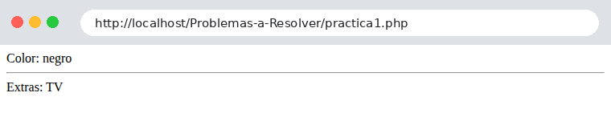
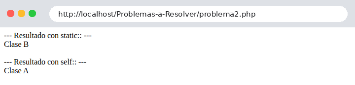
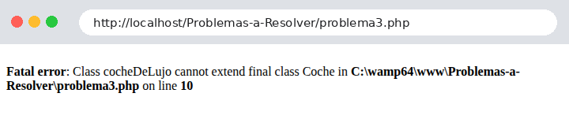
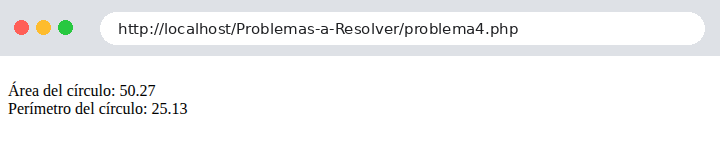
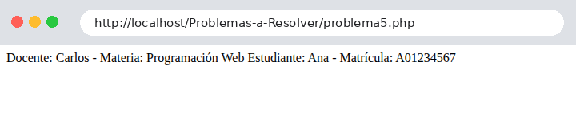
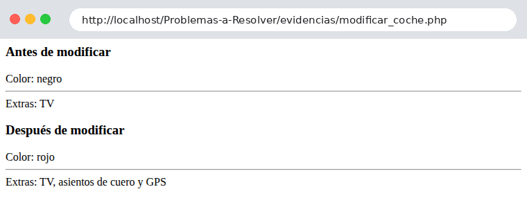
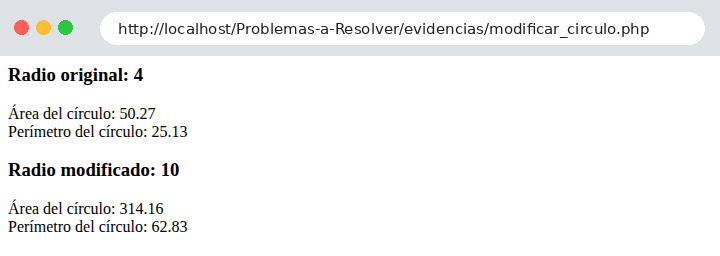
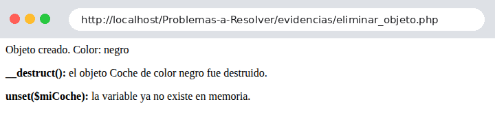

# Prácticas de Programación Orientada a Objetos en PHP

**Herramientas de la Programación Aplicada I**

Este repositorio contiene la solución a la serie de laboratorios y ejercicios prácticos de Programación Orientada a Objetos (POO) en PHP, que abarcan conceptos como herencia, modificadores de acceso, enlace estático en tiempo de ejecución (*Late Static Binding*), restricción de herencia y modelado de clases.

## 📑 Contenido

1. [Insertar registros](#1--insertar-registros-imágenes)
2. [Evidencia de acciones de Modificar](#2--evidencia-de-acciones-de-modificar-imágenes)
3. [Evidencia de acciones de Eliminar](#3--evidencia-de-acciones-de-eliminar-imágenes)
4. [Controles utilizados](#4--controles-utilizados)
5. [Detalles del laboratorio](#5--detalles-del-laboratorio)
6. [Procesos de instalación](#6--procesos-de-instalación)
7. [Tecnologías y versiones](#7--tecnologías-y-versiones)
8. [Detalles del autor, fecha y referencias](#8--detalles-del-autor-fecha-y-referencias)

> 📌 **Nota:** estos ejercicios **no usan base de datos ni formularios**; los "registros" son los **objetos** que se crean (instancias de clase). Por eso: *Insertar* = crear (instanciar) objetos con sus datos, *Modificar* = cambiar los atributos de un objeto, y *Eliminar* = destruir un objeto con `unset()`. Los ejemplos de modificar y eliminar están en la carpeta [`evidencias/`](evidencias/) para que puedan ejecutarse.

---

## 1. 📥 Insertar registros (Imágenes)

Cada programa crea objetos (instancias) con sus datos y muestra el resultado.

### 1.1 Herencia y modificadores de acceso – `practica1.php` (`Coche` y `CocheDeLujo`)
Se crea un `CocheDeLujo` con color `negro` y extras `TV`. La clase hija sobrescribe `printCaracteristicas()`.



### 1.2 Late Static Binding – `problema2.php` (`static::` vs `self::`)
Con `static::` se ejecuta el método de la clase que realiza la llamada (**B**); con `self::` siempre se usa el de la clase donde fue definido (**A**).



### 1.3 Restricción de herencia – `problema3.php` (`final`)
Una clase `final` no puede extenderse: PHP detiene la ejecución con un **error fatal**. Este error es el resultado esperado del ejercicio.



### 1.4 Área y perímetro de un círculo – `problema4.php` (`Circulo`)
Se crea un `Circulo` con radio **4**: área = π·r² = 50.27 y perímetro = 2·π·r = 25.13.



### 1.5 Modelado de dominio – `problema5.php` (`Persona`, `Docente`, `Studente`)
Se crean un docente y un estudiante que heredan de `Persona`. El navegador muestra ambas líneas juntas porque el programa usa `\n` en lugar de `<br>`.



---

## 2. ✏️ Evidencia de acciones de Modificar (Imágenes)

Se modifican los datos de los objetos y el resultado se actualiza.

### 2.1 Modificar los atributos de un objeto – [`evidencias/modificar_coche.php`](evidencias/modificar_coche.php)
Con `setColor()` y `setExtras()` el color cambia de `negro` a `rojo` y los extras de `TV` a `TV, asientos de cuero y GPS`.



### 2.2 Modificar el dato de entrada – [`evidencias/modificar_circulo.php`](evidencias/modificar_circulo.php)
El radio del círculo cambia de `4` a `10` y el área y el perímetro se recalculan.



---

## 3. 🗑️ Evidencia de acciones de Eliminar (Imágenes)

### Eliminar un objeto – [`evidencias/eliminar_objeto.php`](evidencias/eliminar_objeto.php)
Se crea un objeto `Coche`, se elimina con `unset($miCoche)`, se ejecuta automáticamente su destructor `__destruct()` y se comprueba con `isset()` que la variable ya no existe.



---

## 4. 🎛️ Controles utilizados

| Control / concepto | Descripción | Dónde se usa |
|---|---|---|
| `class` / `new` | Definición e instanciación de clases | Todos los programas |
| `extends` | Herencia entre clases | `practica1.php`, `problema2.php`, `problema5.php` |
| `public`, `protected`, `private` | Modificadores de acceso | `practica1.php`, `problema4.php`, `problema5.php` |
| Getters y setters | Lectura y escritura controlada de atributos | `practica1.php`, `problema5.php` |
| Sobrescritura de métodos | La clase hija redefine un método del padre | `practica1.php`, `problema2.php` |
| `static function`, `static::`, `self::` | Métodos estáticos y *Late Static Binding* | `problema2.php` |
| `final class` | Impide que una clase sea extendida | `problema3.php` |
| `__construct()` y `parent::__construct()` | Constructores y llamada al constructor del padre | `problema4.php`, `problema5.php` |
| Propiedades y retornos tipados (`float`, `string`, `int`) | Tipado de atributos, parámetros y valores devueltos | `problema4.php`, `problema5.php` |
| `M_PI`, `number_format()` | Constante matemática y formato numérico | `problema4.php` |
| `unset()`, `__destruct()`, `isset()` | Destrucción de objetos y verificación | `evidencias/eliminar_objeto.php` |
| `echo`, `<br>`, `<hr/>`, `\n`, `\t` | Salida de datos | Todos los programas |

---

## 5. 🧪 Detalles del laboratorio

| Archivo | Tema | Clases | Resultado esperado |
|---|---|---|---|
| `practica1.php` | Herencia y modificadores de acceso | `Coche`, `CocheDeLujo` | Color: negro / Extras: TV |
| `problema2.php` | Late Static Binding | `A`, `B` | `static::` → Clase B · `self::` → Clase A |
| `problema3.php` | Restricción de herencia (`final`) | `Coche` (final), `cocheDeLujo` | Error fatal: la clase final no puede extenderse |
| `problema4.php` | Área y perímetro de un círculo | `Circulo` | Área: 50.27 · Perímetro: 25.13 (radio 4) |
| `problema5.php` | Modelado de dominio | `Persona`, `Docente`, `Studente` | Datos del docente y del estudiante |
| `evidencias/` | Ejemplos de modificar y eliminar | `Coche`, `CocheDeLujo`, `Circulo` | Ver secciones 2 y 3 |

### Estructura del proyecto

```text
Problemas-a-Resolver/
├── practica1.php      # Herencia y modificadores de acceso (Coche / CocheDeLujo)
├── problema2.php      # Late Static Binding (static:: vs self::)
├── problema3.php      # Restricción de herencia (final)
├── problema4.php      # Círculo: área y perímetro
├── problema5.php      # Persona, Docente y Studente
├── evidencias/        # Ejemplos de modificar y eliminar objetos
│   ├── modificar_coche.php
│   ├── modificar_circulo.php
│   └── eliminar_objeto.php
├── imagenes/          # Capturas usadas en este README
└── README.md
```

---

## 6. ⚙️ Procesos de instalación

1. **Instalar WampServer** (Windows) o **XAMPP** y ejecutarlo hasta que el ícono quede en **verde**.
2. **Instalar Visual Studio Code** y **Git**.
3. **Clonar el repositorio** dentro de la carpeta `www` (WampServer) o `htdocs` (XAMPP):
   ```bash
   git clone https://github.com/jazidsanchez-create/Problemas-a-Resolver.git
   cd Problemas-a-Resolver
   ```
4. **Abrir en el navegador** el ejercicio que se desea ver:
   * `http://localhost/Problemas-a-Resolver/practica1.php`
   * `http://localhost/Problemas-a-Resolver/problema2.php` … hasta `problema5.php`
   * `http://localhost/Problemas-a-Resolver/evidencias/modificar_coche.php`

*(Alternativa por consola, con PHP instalado: `php practica1.php`.)*

---

## 7. 🌐 Tecnologías y versiones


| Tecnología | Versión |
|---|---|
| PHP | 7.4 o superior *(usa propiedades tipadas; capturas generadas con PHP 8.3; verifica la tuya con `php -v`)* |
| Apache | 2.4.x *(incluido en WampServer / XAMPP)* |
| WampServer | 3.x |
| Visual Studio Code | Última versión estable |
| Git / GitHub | Git 2.x |

---

## 8. 👨‍💻 Detalles del autor, fecha y referencias

**Autor:** Jazid Sánchez – 8-1038-1191
**Carrera:** Licenciatura en Ciberseguridad
**Institución:** Universidad Tecnológica de Panamá
**Facultad:** Facultad de Ingeniería de Sistemas Computacionales

📧 **Email:** jazid.sanchez@utp.ac.pa
🌐 **GitHub:** https://github.com/jazidsanchez-create

📅 **Fecha de creación:** 2 de octubre de 2026
📅 **Última actualización del README:** 10 de octubre de 2026

### 📚 Referencias

* PHP Documentation Group. (2026). *PHP Manual: Classes and Objects*. https://www.php.net/manual/es/language.oop5.php
* PHP Documentation Group. (2026). *Late Static Bindings*. https://www.php.net/manual/es/language.oop5.late-static-bindings.php
* PHP Documentation Group. (2026). *Final Keyword*. https://www.php.net/manual/es/language.oop5.final.php
* PHP Documentation Group. (2026). *Constructors and Destructors*. https://www.php.net/manual/es/language.oop5.decon.php
* W3Schools. (2026). *PHP OOP – Classes and Objects*. https://www.w3schools.com/php/php_oop_classes_objects.asp
